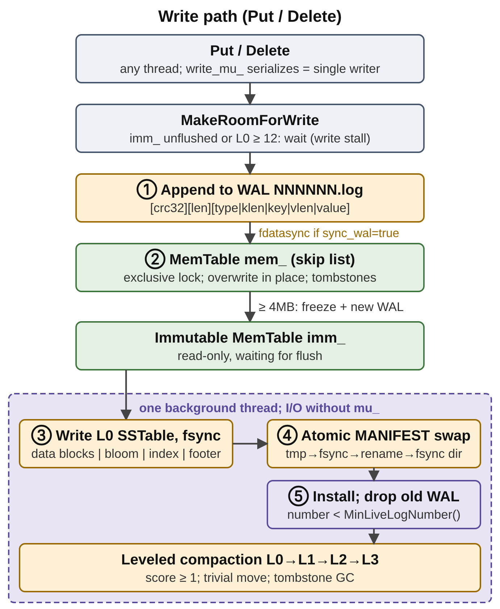
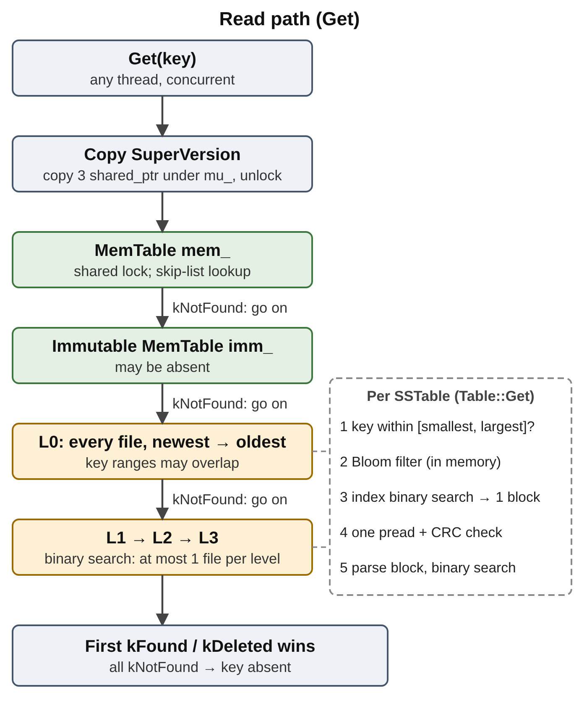

**lsm-kv** is an LSM-tree key-value storage engine written from scratch in C++20. It is modelled on LevelDB and depends only on the standard library and Linux system calls. This handbook condenses the repository's documents and code for interview preparation and for an interviewer's quick read. Every number is quoted from a file in the repository; a superscript [n] points to "Sources" at the end. Code locations are written `file:line` and refer to commit `4f220ed`.

# 1 Overview

**What it does.** A write is appended to the WAL and then inserted into an in-memory skip list (the MemTable). A full MemTable is frozen; a background thread writes it out as an immutable SSTable and merges SSTables with a 4-level leveled compaction. A read searches from newest to oldest. The public API is a thread-safe `Put / Get / Delete / Scan` (`include/kv/db.h:70-78`), plus an epoll TCP server with a text protocol (`SET / GET / DEL / SCAN / PING`).

| Scale | Value | Notes |
|---|---|---|
| Core code | 3,097 lines[2] | `src/` 1,746 + `include/kv/` 1,351, comments and blank lines included; tests add 1,074 lines, benchmark and tools 359 |
| Tests | 41 GoogleTest cases[1] | 38 `TEST` macros; the model-checking test expands over 4 parameter sets[9]. All pass in Release and TSan builds[1] |
| Data races | 0 ThreadSanitizer reports[1] | `scripts/run_tsan.sh`, run under `setarch -R` to disable ASLR |
| Levels and defaults[8] | 4 levels, L0–L3 | MemTable 4MB, data block 4KB, Bloom 10 bits/key, compaction at 4 L0 files, write stop at 12, L1 limit 10MB (×10 per level), output files 2MB |
| Baseline speed[4] | random write 226,253 ops/s; random read 60,921 ops/s | i7-12700H + WSL2, single thread, 500k entries, hot cache, one run[3]; see section 6 |

**In three sentences.** (1) Crash consistency comes from ordering: WAL before MemTable; fsync the SSTable, then swap the MANIFEST atomically, then delete old files. (2) Concurrency comes from immutability: a reader copies three `shared_ptr` handles under a lock, and the frozen table, SSTables and Version it then reads never change. (3) Every simplification has a measurable cost; see sections 3, 6 and 7.

# 2 Modules

## 2.1 Skip-list MemTable

- **Skip list** (`include/kv/skiplist.h`). Height grows with probability 1/4, up to 12 levels, with a fixed seed for reproducibility (`:38-41`, `:110-114`). `FindGreaterOrEqual` descends from the top level and records each level's predecessor in `prev[]` (`:121-130`). `InsertOrAssign` overwrites an existing key and returns the old value (`:58-80`), so the MemTable can correct its memory count without a separate lookup. Nodes are allocated with `new` and keep their forward pointers in a `std::vector` (`:28-35`); there is no arena.
- **MemTable** (`src/memtable.cpp`). One `std::shared_mutex`: shared for reads, exclusive for writes (`:18`, `:39`). A key keeps only its latest value, and a delete writes a tombstone. `Get` returns one of three states, `kFound / kDeleted / kNotFound` (`:38-45`, defined in `include/kv/types.h:23-27`); a tombstone means "deleted for certain, stop searching older data". Memory use is estimated as key size + value size + 96 bytes of node overhead (`:20-25`). `NewIterator` copies the whole table into a snapshot under the shared lock (`:47-59`), so iteration itself holds no lock.

## 2.2 WAL

- **Record format** (`include/kv/wal.h:5-7`): `[crc32:4][len:4][payload]`, where the payload is `[type:1][klen:4][key][vlen:4][value]`. The CRC covers `len` and the payload. Integers are fixed-width little-endian.
- **Writing** (`src/wal.cpp:31-50`). A record is assembled in memory and written with one `write()`; there is no user-space buffer. With `sync_wal=true` each record is followed by `fdatasync`. Each MemTable has its own WAL file, created when the MemTable is switched (`src/db.cpp:160-168`).
- **Truncation recovery** (`src/wal.cpp:52-77`). Replay stops in four cases: fewer than 8 header bytes remain (`:59`), the body is shorter than `len` (`:62`), the CRC does not match (`:65`), or the payload cannot be decoded (`:69`). The first bad record and everything after it are discarded, so the recovered state is always a prefix of what was really written.
- **Opening a database** (`src/db.cpp:41-64`, `:89-112`). All WALs numbered ≥ `log_number` are replayed; if they held data it is flushed to an L0 SSTable at once, a new WAL is started and the old ones are deleted. Nothing is ever appended after a damaged log tail.

## 2.3 SSTable

- **Layout** (`include/kv/sstable_format.h:5-15`): `[data block+crc]… [filter block+crc] [index block+crc] [40-byte footer]`. Data-block entries use the WAL payload format. An index entry is "last key of the block + offset + size". The fixed-size footer at the end of the file holds the positions of the index and the filter and the magic `"KVSSTBL1"` (`:55-56`).
- **Writing** (`src/sstable_builder.cpp:15-47`). A data block is written once it reaches 4KB, and one index entry is appended. `Finish` writes the filter, the index and the footer, then calls `fdatasync`; a file may be referenced by the MANIFEST only after that (`:43-45`).
- **Reading** (`src/sstable.cpp`). `Open` loads the footer, the index and the filter, and reads the first block to learn the smallest key (`:11-27`). `Get` runs Bloom filter → binary search on the index → one `pread` with a CRC check → parse the whole block and binary-search it (`:44-57`). The iterator has two levels (index × entries in a block) and holds a `shared_ptr<Table>`, so the table outlives any iteration over it (`:62-105`).
- **Bloom filter** (`src/bloom.cpp:23-58`). One filter per table. FNV-1a plus fmix64 gives a 64-bit hash, whose two halves drive double hashing. At 10 bits/key, k=7 and the false-positive rate is about 0.8%[10]. Tombstone keys are added too (`src/sstable_builder.cpp:20-21`); otherwise the filter would skip a deleted key and an older file's value would be returned.

## 2.4 MANIFEST and Version

- **Version** (`include/kv/version.h:48-59`). One file list per level. L0 is ordered newest first and its files may overlap; L1 and below are sorted by smallest key and do not overlap. A Version is immutable: flush and compaction copy it, modify the copy and swap it in (`src/db_background.cpp:62`, `src/compaction.cpp:170`).
- **Lookup** (`src/version.cpp:20-36`). L0 checks every file, after excluding by key range. L1–L3 use `FindFileInLevel` to binary-search at most one file per level (`:11-18`).
- **MANIFEST** (`src/version.cpp:50-82`). A text file holding `next_file_number`, `log_number` and one `file <level> <number>` line per SSTable, rewritten in full on every change. It is the only authority on which files are live and at which level; any `.sst` it does not list is an orphan.

## 2.5 Leveled compaction

- **Trigger** (`src/compaction.cpp:49-56`, `:95-107`). L0 score = file count / 4. L1 and L2 score = level bytes / limit (10MB and 100MB). The level with the highest score ≥ 1 is compacted. L3 is the bottom level and is not scored.
- **Picking files** (`:109-121`). L0→L1 takes every L0 file. Li→Li+1 takes one file, chosen round-robin by a compact pointer (`:59-69`). Files in the next level whose key ranges overlap are added.
- **Trivial move** (`include/kv/compaction.h:46`, `src/db_background.cpp:92-94`). With a single input and no overlap below, the file is attached to the next level unchanged; only the MANIFEST is rewritten.
- **Merging** (`src/compaction.cpp:135-166`). Child iterators are ordered newest first and fed to the merging iterator, which emits only the newest version of each key (`src/merging_iterator.cpp:18-35`). Output is split into files of about 2MB.
- **Tombstone removal** (`src/compaction.cpp:39-46`, `:150-152`). A tombstone is dropped only if no file below the output level has a key range covering that key. The test is on key ranges, so it is conservative, but an old value can never reappear.

## 2.6 Concurrency model

- **Single writer.** `write_mu_` serializes every `Put / Delete` and protects the WAL (`src/db.cpp:122-140`). `mu_` is not held while appending to the WAL or inserting into the MemTable.
- **Many readers.** `GetSuperVersion` copies `mem_ / imm_ / current_` under `mu_` and unlocks at once (`src/db.cpp:176-180`). A reader holding an old Version also holds its Tables and their fds, so a file can still be read to the end after `unlink` (`src/db_background.cpp:168-169`).
- **One background thread** (`src/db_background.cpp:17-48`). Flush has priority, then manual compaction, then automatic compaction. The pattern is always "take state under the lock → do I/O unlocked → install the new version under the lock" (`:53-58`, `:96-103`). Only this thread modifies `current_`. On failure it records `bg_error_`, and every later write throws (`:24-27`, `src/db.cpp:170-172`).
- **Write stall** (`src/db.cpp:142-157`). When the MemTable is full, the writer waits on a condition variable if the previous frozen table is still unflushed or L0 holds ≥ 12 files. Otherwise it switches MemTables and wakes the background thread.
- **Lock order** is fixed: `write_mu_ → mu_ → MemTable's internal lock` (`include/kv/db.h:21`).

## 2.7 epoll TCP server

- **Structure** (`src/server.cpp:89-116`). A single reactor: one thread runs `epoll_wait` and executes commands synchronously. The listening socket and all connections are non-blocking. It is level-triggered, yet reads and writes loop until `EAGAIN`.
- **Framing** (`:153-169`). Bytes go into a per-connection input buffer; complete commands are cut at `'\n'` and executed in order, and a partial command waits for more data. A line longer than 1MB is rejected and the connection closed.
- **Output and backpressure** (`:171-198`). A response is first sent directly (with `MSG_NOSIGNAL`); `EPOLLOUT` is watched only while unsent data remains. If the output buffer exceeds 4MB, the server stops reading from that connection.
- **Shutdown** (`:82-87`). `Stop()` does only an atomic store and a `write` to an eventfd, so it may be called from a signal handler. Protocol parsing lives in `src/protocol.cpp`, apart from the network layer, and is tested without sockets. `SCAN` returns at most 1000 rows (`include/kv/protocol.h:32`).

# 3 Key trade-offs

Ten decisions chosen from `docs/DECISIONS.md`[11], each checked against the code. The LevelDB column follows the descriptions in the repository's documents and comments.

| # | What was chosen (code) | How LevelDB differs | Cost |
|---|---|---|---|
| 1 | MemTable overwrites in place; no sequence numbers (`memtable.cpp:17-26`) | Keeps versions under an internal key `(user_key, seq, type)` | No snapshot reads or MVCC; a Scan is consistent only within one call |
| 2 | Locked skip list; the iterator copies the whole table (`memtable.cpp:47-59`) | Lock-free single-writer skip list, iterated directly; arena allocation | Scan cost grows with MemTable size: 91 ops/s at 16MB[6] |
| 3 | WAL of simple fixed-header records; stop at the first bad record (`wal.cpp:59-69`) | 32KB blocks with FULL/FIRST/MIDDLE/LAST fragments, so a reader can resync after damage | Cannot skip mid-file corruption; replay loads the whole log into memory |
| 4 | Text MANIFEST rewritten in full on each change (`version.cpp:50-56`) | Appends VersionEdit records to the MANIFEST | Writes the full file list every time, with the fsync done while holding `mu_` (`db_background.cpp:66-67`) |
| 5 | One Bloom filter per table; index and filter stay in memory; no block cache (`sstable.cpp:35-40`) | One filter per 2KB of data, plus an LRU block cache | Every hit reads a block with `pread` and parses all of it: readrandom averages 16.39us[4] |
| 6 | Data blocks without prefix compression or restart points (`sstable_format.cpp:43-50`) | Shared prefixes, a restart point every 16 entries, binary search in the block | Larger files; one lookup parses a block into about 35 `std::string` objects[7] |
| 7 | Only 4 levels; L0→L1 takes all L0 files (`compaction.cpp:111-114`) | 7 levels; picks one L0 file and expands to those overlapping it | Sequential writes are rewritten once at L0→L1: fillseq write amplification 2.13[4] |
| 8 | Single-writer mutex, no group commit (`db.cpp:123`) | A writer queue merges several writes into one batch | Writers never run in parallel; with `sync_wal=true` each write pays its own `fdatasync` (not benchmarked[7]) |
| 9 | One background thread runs flush and compaction serially (`db_background.cpp:38-48`) | RocksDB supports several compaction threads | No flush during a large compaction, so writers may stall on an unflushed `imm_`[12] |
| 10 | Write stall is a hard stop only (`db.cpp:146-152`) | At 8 L0 files, first slows each write with a 1ms sleep | A latency cliff: with a 1MB MemTable, writes average 13.35us while p50 is 1.13us[6] |

# 4 Crash consistency

**4.1 Truncating the WAL at every byte offset** (`tests/wal_test.cpp:64-89`). The test writes 4 records (a value, a tombstone, an empty key, a 1000-byte value) and replays the log once for every truncation point from 0 to the file length. It asserts three things: the number of replayed records equals the number written completely; the records are a prefix of the original sequence; `valid_bytes` equals the end offset of the last complete record. Two related tests flip one bit (`:91-101`) and, at the DB level, cut 3 bytes off the WAL, reopen, write again and reopen once more (`tests/db_test.cpp:59-79`).

**4.2 Atomic MANIFEST replacement** (`src/file.cpp:125-136`). The steps are: write `MANIFEST.tmp` → `fdatasync` → `rename` over `MANIFEST` → `fsync` the directory.

| Crash point | State seen after restart |
|---|---|
| Before `rename` | The old MANIFEST is intact. A leftover `MANIFEST.tmp` is not parsed as a data file (`include/kv/filename.h:39-49`) and is truncated by the next write |
| After `rename`, before the directory `fsync` | Either the old file or the new one; each is complete |
| After the directory `fsync` | The new MANIFEST is durable |

The same directory `fsync` also makes the directory entries of newly written SSTables durable (`src/db_background.cpp:82`).

**4.3 Crash during a flush** (`src/db_background.cpp:52-71`). The order is: (1) write the SSTable and `fdatasync` it → (2) write the MANIFEST atomically, advancing `log_number` to the current WAL → (3) install the new Version → (4) delete the old WAL.

| Crash point | Why recovery works |
|---|---|
| During (1), or between (1) and (2) | The new `.sst` is not in the MANIFEST and is deleted as an orphan at startup (`src/db_background.cpp:156-171`; test `tests/db_test.cpp:144-154`). The old WAL's number is ≥ `log_number`, so it is replayed (`src/db.cpp:98`) |
| After (2), before (4) | The data is in the SSTable. The old WAL's number is < `log_number`, so it is not replayed and is deleted at startup |

**4.4 Crash during a compaction** (`src/db_background.cpp:90-113`). All output files are written and synced first, then the MANIFEST is written, then the inputs are deleted. A crash before the MANIFEST update leaves the outputs as orphans and the inputs still live; a crash after it leaves the inputs as orphans. In both cases exactly one copy of the data is live, so nothing is lost or duplicated. A trivial move is a single MANIFEST write.

**4.5 Two details that are easy to miss.**

- **File numbers** (`src/db.cpp:95-97`). The `next_file_number` in the MANIFEST can lag, for example when a new WAL was created but the process crashed before the next MANIFEST write. At startup it is raised to "largest number in the directory + 1" so that no number is reused.
- **`MinLiveLogNumber()`** (`include/kv/db.h:122`). When a compaction writes the MANIFEST while a frozen table is still unflushed, `log_number` must stay at the frozen table's WAL; otherwise that WAL would be deleted as obsolete. This bug cannot occur in a synchronous design and appeared only once the background thread was introduced[11].

**4.6 What a power failure loses with `sync_wal=false` (the default).**

- **A process crash loses nothing.** Every record has already entered the kernel page cache through `write()` (`src/file.cpp:41-57`).
- **A power failure or kernel crash** loses the WAL tail that the kernel had not yet written back. The loss is confined to data not yet flushed to an SSTable, that is, the current MemTable and any unflushed frozen table. Flushed data is unaffected, because SSTables and the MANIFEST are always synced.
- The next three points are **inferences from reading the code; no test in the repository covers them**:
  - "Recovery yields a prefix" holds for one WAL only. When a frozen table and the current table each have a WAL, `ReplayLogs` replays them in turn without checking that the earlier one is complete (`src/db.cpp:102-111`). If a power failure loses the older WAL's tail while the newer WAL's contents reached disk, the recovered state has a gap in the middle.
  - Creating a new WAL does not `fsync` the directory (`src/db.cpp:162-163`); its directory entry is explicitly made durable only by the next MANIFEST write.
  - `sync_wal=true` removes the first problem at the cost of one `fdatasync` per write. The repository has no benchmark for that setting[7].

# 5 Testing strategy

| Technique | What it does | Location |
|---|---|---|
| Randomized comparison with `std::map` | 4 configurations (Bloom on/off; MemTable 8KB / 64KB / 1MB), 20,000 operations each by default[9]: 50% Put, 20% Delete, 25% Get, 3% Scan, the rest `CompactAll` and restarts. Level limits are tiny (L1 32KB, output files 8KB) so data quickly reaches L2 and L3. The full contents are compared at the end and again after a restart | `tests/db_fuzz_test.cpp:66-104` |
| Multi-threaded stress | 1 writer + 4 readers. Values have the form `<key>#<round>`. A reader notes the completed round r before reading; the value it reads must exist, belong to the key and carry a round ≥ r. Scans must be ordered and complete. A second test has 4 threads Put and Delete concurrently, then verifies everything | `tests/concurrency_test.cpp:46-120` |
| ThreadSanitizer | All tests run in a TSan build with 0 reports[1]. Recent kernels need ASLR off; the script uses `setarch -R` | `scripts/run_tsan.sh` |
| Format and corruption | CRC reference vector; WAL truncation at every byte and a bit flip; SSTable block corruption and non-SSTable files; orphan cleanup | `tests/wal_test.cpp`, `tests/sstable_test.cpp`, `tests/db_test.cpp` |
| Compaction invariants | After 20 rounds of overwriting 1000 keys, total SSTable size is < 3× live data and there are < 15 files. Deleting everything and calling `CompactAll` leaves 0 files. Data is ordered after a restart | `tests/compaction_test.cpp:29-84` |

The comparison test earns its place because restarts, multi-level compaction and tombstone shadowing combine in ways hand-written cases rarely reach, while the model (`std::map`) is too simple to be wrong. The concurrency test rests on an invariant that remains checkable under concurrency ("a read never returns a round older than one completed before the read began"), which is stronger than checking that nothing crashes.

# 6 Performance

**Environment**[3]: i7-12700H (20 threads), WSL2 Ubuntu 24.04, ext4, Release `-O2`. 500,000 entries with 16-byte keys and 100-byte values (about 58MB). All data is in the OS page cache (hot reads); each configuration ran once, with about ±10% variation; single-threaded. The numbers below are quoted unchanged from `docs/PROGRESS.md` and were not rerun on another machine.

**Table 1. Baseline** (Bloom on, MemTable 4MB)[4]

| benchmark | ops/s | avg(us) | p50 | p99 |
|---|---:|---:|---:|---:|
| fillseq | 369,652 | 2.67 | 1.17 | 4.31 |
| fillrandom | 226,253 | 4.39 | 1.84 | 7.59 |
| readrandom | 60,921 | 16.39 | 15.39 | 34.32 |
| readmissing | 941,405 | 1.04 | 0.72 | 15.29 |
| scan (100 rows) | 760 | 1,316 | 1,159 | 3,521 |

**Table 2. Bloom filter on / off** (MemTable 4MB)[5]

| benchmark | on ops/s | off ops/s | on blk/op | off blk/op |
|---|---:|---:|---:|---:|
| readrandom | 60,921 | 46,661 | 0.993 | 1.388 |
| readmissing | 941,405 | 43,213 | 0.013 | 1.539 |

fillseq: write amplification 2.13, with 1/5/25 files in L0/L1/L2. fillrandom: write amplification 4.60, 21 compactions[4].

**Table 3. MemTable threshold** (Bloom on)[6]

| MemTable | fillrandom ops/s | write avg / p50 (us) | write amp. | compactions | readrandom ops/s | scan ops/s |
|---|---:|---:|---:|---:|---:|---:|
| 1MB | 74,753 | 13.35 / 1.13 | 8.61 | 44 | 74,118 | 3,189 |
| 4MB | 226,253 | 4.39 / 1.84 | 4.60 | 21 | 60,921 | 760 |
| 16MB | 274,014 | 3.62 / 2.55 | 1.74 | 1 | 42,979 | 91 |

**Analysis**[7]

1. **Write amplification, sequential versus random (2.13 versus 4.60).** Sequential keys produce SSTables that do not overlap, so L1→L2 finds nothing to merge below and uses a trivial move. Random keys force each compaction to rewrite the overlapping files in the next level. fillseq is still 2 and not 1 because L0→L1 takes every L0 file and always rewrites them (trade-off 7).
2. **A smaller MemTable means more write amplification and more stalls.** At 1MB, write amplification is 8.61 with 44 compactions. The average latency is 13.35us while p50 is 1.13us: most writes are fast and a few wait for the background thread, which pulls the average up. At 16MB, L0 files are few and large, and write amplification falls to 1.74.
3. **A larger MemTable means slower reads.** Scan shows it most: 91 ops/s at 16MB (about 11ms each), because the iterator copies the whole MemTable whatever the number of rows scanned. readrandom also drops from 60,921 to 42,979. The document suggests more cache misses in a larger skip list and overlapping large L0 files, but states that this was **not confirmed with perf**.
4. **The Bloom filter helps most for absent keys (about 22×).** Without it, every file whose range covers the key costs one block read (1.539 blocks/op); with it the figure is 0.013. For present keys the gain is about 30% (1.388 → 0.993 blocks/op): the final block must be read anyway, and the filter only skips unrelated files above it.
5. **A point lookup's cost is almost entirely "read one block and parse it".** readrandom takes about 15us, whereas a readmissing stopped by the filter takes 0.7us.
6. **Read/write asymmetry is inherent to an LSM-tree.** A write is a WAL append plus a MemTable insert (p50 of 1–2us); a read may visit several levels. Filters and compaction policies trade write amplification and space for lower read amplification.

# 7 Known defects and simplifications

**Acknowledged in the repository's documents**[12]

- **L0→L1 compacts all of L0.** Sequential writes cannot be moved trivially; fillseq write amplification is 2.13[4].
- **The benchmark is single-threaded.** Multi-threaded read scaling and `sync_wal=true` were not measured; each configuration ran once, on a hot cache.
- **No snapshot reads or MVCC.** Records carry no sequence number; there are no transactions and no WriteBatch.
- **No group commit.** A single-writer mutex; writers do not share WAL writes.
- **No block cache, prefix compression or restart points.** Every point lookup reads and parses a whole block.
- **MemTable iteration copies the whole table.** Scans are slow with a large MemTable.
- **One background thread.** No flush during a large compaction, which causes write stalls; a stall is a hard stop with no gradual slowdown.
- **Single reactor.** One large SCAN or one write stall makes every connection wait.
- **A background error is final.** All later writes throw; there is no retry and no read-only mode.
- **Linux only.** It relies on epoll, eventfd and on reading through an fd after `unlink`.

**Also noticed while reading the code** (inferences, not verified by tests)

- No prefix guarantee across several WALs; no directory `fsync` when a WAL is created (see 4.6).
- Each SSTable keeps one fd open for as long as its Version lives (`include/kv/version.h:39-41`). There is no table cache, so a large file count runs into the process fd limit.
- The tombstone check scans every file in the deeper levels linearly (`src/compaction.cpp:39-46`); the merging iterator finds the minimum linearly at each step (`src/merging_iterator.cpp:28-35`).
- A failed SSTable block checksum throws straight to the caller; there is no repair or skip path (`src/sstable_format.cpp:102`).

# 8 Interview Q&A

Based on the 15 questions in section 3 of `docs/LEARNING_GUIDE.md`, selected and reordered into 14. All line numbers were checked against the code.

**Q1 Why write the WAL before the MemTable? What if the order were reversed?**

- The MemTable vanishes on power loss; the log is the only durable copy.
- Reversed, a crash after the MemTable insert and before the log append could erase a write that another reader had already seen.
- Logging first guarantees that any write ever observed can be recovered.
- Appending is sequential I/O, one reason LSM writes are fast.
- Code: `src/db.cpp:131-139`, `include/kv/db.h:7-9`.

**Q2 What does the WAL tail look like after a crash mid-write? Why not skip the bad record?**

- The tail may be half a record, or garbage that fails the checksum.
- Replay stops at the first bad record.
- After a bad record the length field cannot be trusted, so the next record boundary is unknown.
- Recovering only a prefix guarantees a state that really existed.
- The byte-by-byte truncation test covers every offset.
- Code: `src/wal.cpp:59-69`, `tests/wal_test.cpp:64-89`.

**Q3 Can a crash at any step of a flush lose data?**

- Order: `fdatasync` the SSTable → write the MANIFEST atomically and advance `log_number` → delete the old WAL.
- Crash between the first two steps: the SSTable is an orphan and is deleted at startup; the WAL is replayed.
- Crash between the last two: the old WAL's number is below `log_number`, so it is deleted at startup.
- `next_file_number` may lag and is corrected from the largest number in the directory.
- Code: `src/db_background.cpp:52-71`, `src/db.cpp:95-98`.

**Q4 Which bug appeared only after adding concurrency?**

- If a background compaction wrote the current WAL's number as `log_number`, the frozen table's older WAL would be deleted as obsolete.
- The frozen table is not yet on disk, so a crash at that moment would lose its data.
- The fix is `MinLiveLogNumber()`, which returns the frozen table's WAL number while one exists.
- Both the MANIFEST write and file cleanup use it as the boundary.
- Code: `include/kv/db.h:122`, `src/db_background.cpp:110`, `:162`.

**Q5 Is data safe once `write()` returns?**

- `write` only copies into the page cache: safe against a process crash, lost on power failure.
- `fsync` flushes data and all metadata; `fdatasync` flushes data and only the metadata needed to read it. This project uses the latter.
- Creating a file and `rename` change a directory entry, which is durable only after an `fsync` of the directory.
- `write` may be short or interrupted by a signal, hence the loop.
- Code: `src/file.cpp:41-62`, `:117-136`.

**Q6 When can a tombstone really be deleted?**

- Only when no deeper level can hold an older version of the key.
- Dropping it earlier would bring a deeper old value back to life.
- The test used here: no file below the output level has a key range covering the key.
- This reclaims space earlier than "drop only at the bottom level".
- Test: delete everything, call `CompactAll`, and the file count is zero.
- Code: `src/compaction.cpp:39-46`, `:150-152`; `tests/compaction_test.cpp:52-70`.

**Q7 Why may L0 files overlap while L1+ may not? Why does L0→L1 take every file?**

- L0 files come straight from MemTables and cover arbitrary ranges, so a lookup must check each one.
- L1+ files do not overlap, so one binary search finds the single candidate file per level.
- Taking only some L0 files could leave older data in a shallower level, breaking "deeper is older".
- Taking all is the simplest correct choice; the cost is rewriting sequential writes too.
- Code: `src/version.cpp:20-36`, `src/compaction.cpp:111-114`.

**Q8 How is the Bloom filter's false-positive rate computed? Why do the two query types gain so differently?**

- p ≈ (1 − e−kn/m)k; about 0.8% at 10 bits/key with k=7[10].
- False positives only, never false negatives.
- Absent key: each covering file would cost a block read, and the filter removes nearly all of them, about 22×[7].
- Present key: the final block must be read; only unrelated upper files are skipped, about 30%[7].
- It does not help range queries.
- Code: `src/bloom.cpp:23-58`, `include/kv/bloom.h:9`.

**Q9 What is the lock order? Why does a reader copy only three pointers under the lock?**

- The order is fixed as `write_mu_ → mu_ → MemTable's internal lock`, which rules out a circular wait.
- A reader copies `shared_ptr` handles under the lock and searches outside it.
- The frozen table, SSTables and Version are immutable and need no lock; the writable MemTable has its own reader-writer lock.
- A long Scan cannot block the writer from switching MemTables.
- Code: `include/kv/db.h:15-21`, `src/db.cpp:176-180`.

**Q10 A compaction deletes an SSTable while another thread is reading it. Does that fail?**

- No. The reader holds a `shared_ptr` to the old Version, which keeps the Table and its fd alive.
- On Linux `unlink` removes only the directory entry; the inode is freed when the last fd closes.
- An iterator shares ownership of the Table through `shared_from_this`.
- Building a `shared_ptr` from `this` would create a second control block and a double destruction.
- Code: `src/db_background.cpp:168-169`, `include/kv/sstable.h:61`, `src/sstable.cpp:103-105`.

**Q11 What is a write stall? When does it occur here?**

- When writes outpace flush and compaction for long, writers must wait, or memory and L0 grow without bound.
- Condition: the MemTable is full, and either the previous frozen table is unflushed or L0 has ≥ 12 files.
- In the benchmark: with a 1MB MemTable, writes average 13.35us against a p50 of 1.13us[6].
- It is a hard stop; there is no gradual slowdown.
- Code: `src/db.cpp:142-157`, `include/kv/options.h:37`.

**Q12 When the background thread throws, what state is the `unique_lock` in?**

- Flush and compaction `unlock()` temporarily for I/O, so an exception may be thrown with the lock released.
- The `catch` branch checks `owns_lock()` and relocks if needed before writing `bg_error_`.
- Without that, writing shared state is a data race and the following `wait` is undefined behaviour.
- After an error `HasBackgroundWork` returns false: the background thread stops and all writes fail.
- Code: `src/db_background.cpp:22-28`, `:33-36`.

**Q13 How are TCP message boundaries handled?**

- TCP is a byte stream without message boundaries; one `read` may return half a command or several.
- Bytes are appended to the connection's input buffer.
- Complete commands are cut at `'\n'` and executed in order; a partial command waits for the next read.
- A line over 1MB is treated as abuse and the connection is closed.
- Tests cover pipelined commands and a command sent in pieces.
- Code: `src/server.cpp:153-169`, `tests/server_test.cpp`.

**Q14 Level-triggered versus edge-triggered? Why not always watch EPOLLOUT? What if a client never reads?**

- LT reports as long as data remains; ET reports once per state change and requires reading until `EAGAIN`. This server uses LT and still reads until `EAGAIN`.
- A socket is almost always writable, so watching `EPOLLOUT` permanently makes `epoll_wait` spin.
- `EPOLLOUT` is watched only while the output buffer is non-empty.
- Above 4MB of pending output the server stops reading from that connection, which gives backpressure.
- Code: `src/server.cpp:171-198`, `include/kv/server.h:15-23`.

# Appendix A. Gaps

1. **The tests could not be run in this environment.** `scripts/build_and_test.sh` failed while downloading GoogleTest. The manual download of the v1.14.0 source described in `docs/BLOCKERS.md` was also refused by the environment's network policy (HTTP 403), and no GoogleTest is installed on the system. As agreed, no network package was installed. Substitute checks: counting in `tests/` gives 38 `TEST` macros plus the 4 parameter sets of the comparison test, 41 in total, which matches the README; and with `-DKV_BUILD_TESTS=OFF` the library, `kv_server`, `kv_cli` and `db_bench` compile under g++ 13.3. **"41 tests pass" and "0 TSan reports" are quoted from the repository's documents and were not reproduced here.**
2. **The benchmarks were not rerun.** Every number in section 6 comes from `docs/PROGRESS.md` and is a single run on an i7-12700H under WSL2.
3. **The diagrams were not rendered with Mermaid or Graphviz.** Neither is available in the environment and network installs were not allowed. `diagrams/gen_diagrams.py` generates SVG, which headless Chromium renders to PNG. The script and the SVG files are committed.
4. **Claims with no support in the repository.** There is no fault-injection, `kill -9` or power-loss test; crashes are simulated by truncating files and planting garbage files. There is no benchmark for `sync_wal=true` or for multi-threaded reads. The cause of the readrandom slowdown at 16MB was not confirmed with perf. CMake accepts `KV_SANITIZE=address`, but no ASan run is recorded.
5. **Small mismatches between documents and code.** `docs/DECISIONS.md:24` and a comment at `tests/db_test.cpp:73` still say recovery "physically truncates" the WAL; since Phase 3 it replays, flushes and starts a new WAL (`docs/DECISIONS.md:35`). `docs/PROGRESS.md:69` gives 35 tests under TSan, the Phase 6 figure; the final count is 41 (`:152`). `docs/LEARNING_GUIDE.md:170` says "about 3000 lines" of core code; `wc -l` gives 3,097.
6. **The LevelDB comparisons** follow the repository's own documents and comments and were not checked line by line against LevelDB's source. Items marked as inferences in sections 4.6 and 7 come from reading the code and have no test behind them.

# Sources

- [1] `README.md:16`; `docs/PROGRESS.md:152` (41 tests pass in Release and TSan builds).
- [2] `wc -l` at commit `4f220ed`: `src/*.cpp` 1,746, `include/kv/*.h` 1,351, `tests/*` 1,074, `bench/* tools/*` 359.
- [3] `docs/PROGRESS.md:103-104`.
- [4] `docs/PROGRESS.md:106-114`.
- [5] `docs/PROGRESS.md:116-121`.
- [6] `docs/PROGRESS.md:123-129`.
- [7] `docs/PROGRESS.md:131-142`.
- [8] `include/kv/options.h:18-42`; `include/kv/version.h:37`.
- [9] `tests/db_fuzz_test.cpp:16-19`, `:102-104`; `grep -c TEST tests/*.cpp`.
- [10] `include/kv/bloom.h:9`; `include/kv/options.h:28`; `src/bloom.cpp:25`.
- [11] `docs/DECISIONS.md:7`, `:8`, `:11`, `:23-24`, `:32-34`, `:42`, `:52`, `:54`, `:64`, `:67-69`.
- [12] `docs/PROGRESS.md:71`, `:95`, `:142`, `:154`.

