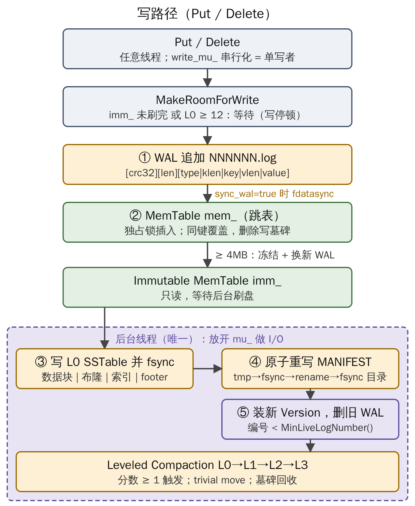
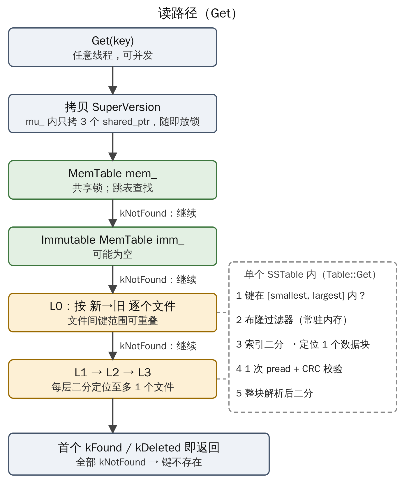

**lsm-kv**：用 C++20 从零实现的 LSM-tree 键值存储引擎，结构参考 LevelDB，只依赖标准库和 Linux 系统调用。本手册是对仓库文档与代码的提炼，面向面试前复习与面试官速览。所有数字均引自仓库文件，上标 [n] 对应文末"数据来源"；代码位置写作 `文件:行号`，基于提交 `4f220ed`。

# 1 一页概览

**做什么。** 写入先追加 WAL，再插入内存跳表（MemTable）；MemTable 满后冻结，由后台线程顺序写成不可变的 SSTable，并用 4 层 Leveled Compaction 合并；读从新到旧逐层查找。对外是线程安全的 `Put / Get / Delete / Scan`（`include/kv/db.h:70-78`），外加一个 epoll 文本协议 TCP 服务（`SET / GET / DEL / SCAN / PING`）。

| 规模 | 数值 | 说明 |
|---|---|---|
| 核心代码 | 3,097 行[2] | `src/` 1,746 + `include/kv/` 1,351（含注释和空行）；另有测试 1,074 行、基准与工具 359 行 |
| 测试 | 41 个 GoogleTest 用例[1] | 38 个 `TEST` 宏，其中对拍测试按 4 组参数展开[9]；Release 与 TSan 构建下均通过[1] |
| 数据竞争 | ThreadSanitizer 0 报告[1] | `scripts/run_tsan.sh`，用 `setarch -R` 关闭 ASLR 后运行 |
| 层数与默认参数[8] | L0–L3 共 4 层 | MemTable 4MB，数据块 4KB，布隆 10 bit/key，L0 满 4 个文件触发压缩、12 个停写，L1 上限 10MB（每层 ×10），输出文件 2MB |
| 基线性能[4] | 随机写 226,253 ops/s；随机读 60,921 ops/s | i7-12700H + WSL2，单线程，50 万条，热缓存，单次运行[3]；详见第 6 节 |

**三句话讲完。** ① 崩溃一致性靠"顺序"保证：先 WAL 后内存表；先 fsync SSTable、再原子换 MANIFEST、最后删旧文件。② 并发靠"不可变"保证：读者在锁内只拷贝三个 `shared_ptr`，之后读到的冻结表、SSTable、Version 都不会再变。③ 性能上的每个简化都有可度量的代价，见第 3、6、7 节。

# 2 模块讲解

## 2.1 跳表 MemTable

- **跳表**（`include/kv/skiplist.h`）：层高以 1/4 概率增长、最高 12 层、随机种子固定以便复现（`:38-41`、`:110-114`）。`FindGreaterOrEqual` 自顶向下查找并在 `prev[]` 里记下每层前驱（`:121-130`）；`InsertOrAssign` 同键覆盖并返回旧值（`:58-80`），MemTable 据此修正内存统计，不必"先查后插"走两遍。节点用 `new` 分配、后继指针放在 `std::vector` 里（`:28-35`），没有 Arena。
- **MemTable**（`src/memtable.cpp`）：一把 `std::shared_mutex`，读共享、写独占（`:18`、`:39`）。同一个键只保留最新值，删除写入墓碑。`Get` 返回三态 `kFound / kDeleted / kNotFound`（`:38-45`，定义在 `include/kv/types.h:23-27`）：墓碑表示"确定已删，不必再查更老的数据"。内存占用按 键长 + 值长 + 96 字节节点开销估算（`:20-25`）。`NewIterator` 在共享锁内把整张表拷贝成快照（`:47-59`），迭代期间不持锁。

## 2.2 WAL

- **记录格式**（`include/kv/wal.h:5-7`）：`[crc32:4][len:4][payload]`，payload 为 `[type:1][klen:4][key][vlen:4][value]`；crc 覆盖 len 与 payload；整数为小端定长。
- **写入**（`src/wal.cpp:31-50`）：整条记录拼好后一次 `write()`，没有用户态缓冲；`sync_wal=true` 时每条记录后 `fdatasync`。每张 MemTable 对应一个 WAL 文件，切换 MemTable 时同时新建 WAL（`src/db.cpp:160-168`）。
- **截断恢复**（`src/wal.cpp:52-77`）：重放在四种情况下停止——剩余字节不足 8 字节头（`:59`）、记录体长度不够（`:62`）、crc 不符（`:65`）、payload 无法解析（`:69`）。第一条坏记录及其后的内容全部丢弃，恢复结果一定是真实写入序列的一个前缀。
- **打开数据库**（`src/db.cpp:41-64`、`:89-112`）：重放所有编号 ≥ `log_number` 的 WAL，有数据就立刻刷成 L0 SSTable，然后换新 WAL、删除旧 WAL。因此不需要在残缺的日志尾部继续追加。

## 2.3 SSTable

- **布局**（`include/kv/sstable_format.h:5-15`）：`[数据块+crc]… [过滤器块+crc] [索引块+crc] [footer 40 字节]`。数据块记录格式与 WAL 的 payload 相同；索引项是"该块最后一个键 + offset + size"；footer 定长置于文件末尾，含索引与过滤器的位置和 magic `"KVSSTBL1"`（`:55-56`）。
- **写**（`src/sstable_builder.cpp:15-47`）：数据块攒到 4KB 落盘并追加一条索引；`Finish` 依次写过滤器、索引、footer，最后 `fdatasync`——只有落盘之后才允许被 MANIFEST 引用（`:43-45`）。
- **读**（`src/sstable.cpp`）：`Open` 读入 footer、索引、过滤器，并读第一个块得到最小键（`:11-27`）。`Get`：布隆过滤器 → 索引二分 → 一次 `pread` 读块并校验 crc → 整块解析后二分（`:44-57`）。迭代器是"索引 × 块内记录"两级结构，并持有 `shared_ptr<Table>`，保证迭代期间表不被析构（`:62-105`）。
- **布隆过滤器**（`src/bloom.cpp:23-58`）：每个表一个；FNV-1a + fmix64 得到 64 位哈希，拆成两半做双重哈希；10 bit/key 时 k=7，误判率约 0.8%[10]。墓碑的键也进过滤器（`src/sstable_builder.cpp:20-21`），否则已删除的键会被过滤器跳过，读到更老文件里的旧值。

## 2.4 MANIFEST 与 Version

- **Version**（`include/kv/version.h:48-59`）：每层一个文件列表。L0 按编号从新到旧排列，文件之间可重叠；L1 及以下按最小键排序且互不重叠。Version 不可变，刷盘和压缩都是拷贝后修改再整体替换（`src/db_background.cpp:62`、`src/compaction.cpp:170`）。
- **查找**（`src/version.cpp:20-36`）：L0 逐个文件查，先用键范围排除；L1–L3 每层用 `FindFileInLevel` 二分定位至多一个文件（`:11-18`）。
- **MANIFEST**（`src/version.cpp:50-82`）：文本文件，内容为 `next_file_number`、`log_number` 和若干行 `file <层> <编号>`；每次变更整体重写。它是"哪些文件有效、各在哪一层"的唯一依据，目录中未被它引用的 `.sst` 一律视为孤儿。

## 2.5 Leveled Compaction

- **触发**（`src/compaction.cpp:49-56`、`:95-107`）：L0 分数 = 文件数 / 4；L1、L2 分数 = 层字节数 / 上限（10MB、100MB）；挑分数最高且 ≥ 1 的层。L3 是最底层，不参与评分。
- **选文件**（`:109-121`）：L0→L1 取全部 L0 文件；Li→Li+1 按 compact pointer 轮转取一个文件（`:59-69`）；再加上下一层键范围重叠的文件。
- **trivial move**（`include/kv/compaction.h:46`、`src/db_background.cpp:92-94`）：只有一个输入且下层无重叠时，文件原样挂到下一层，只改 MANIFEST。
- **合并**（`src/compaction.cpp:135-166`）：子迭代器按新→旧排列交给归并迭代器，同键只输出最新版本（`src/merging_iterator.cpp:18-35`）；输出按 2MB 切成多个文件。
- **墓碑回收**（`src/compaction.cpp:39-46`、`:150-152`）：仅当输出层以下所有层都没有文件的键范围覆盖该键时，才丢弃墓碑；判断基于键范围，偏保守但不会让旧值复活。

## 2.6 并发模型

- **单写者**：`write_mu_` 串行化所有 `Put / Delete` 并保护 WAL（`src/db.cpp:122-140`）；写 WAL 和插入 MemTable 时不持有 `mu_`。
- **多读者**：`GetSuperVersion` 在 `mu_` 下拷贝 `mem_ / imm_ / current_` 三个指针后立即放锁（`src/db.cpp:176-180`）。读者持有旧 Version 就持有其中的 Table 和 fd，文件即使已被 `unlink` 也能读完（`src/db_background.cpp:168-169`）。
- **一个后台线程**（`src/db_background.cpp:17-48`）：刷盘优先，其次手动压缩，再次自动压缩。模式统一为"持锁取状态 → 放锁做 I/O → 持锁装新版本"（`:53-58`、`:96-103`）。只有它修改 `current_`。出错后写入 `bg_error_`，此后所有写入抛异常（`:24-27`、`src/db.cpp:170-172`）。
- **写停顿**（`src/db.cpp:142-157`）：MemTable 写满时，如果上一张冻结表还没刷完，或 L0 文件数 ≥ 12，写者在条件变量上等待；否则切换 MemTable 并唤醒后台。
- **加锁顺序**固定为 `write_mu_ → mu_ → MemTable 内部锁`（`include/kv/db.h:21`）。

## 2.7 epoll TCP 服务

- **结构**（`src/server.cpp:89-116`）：单 Reactor，一个线程跑 `epoll_wait`，命令在同一线程内同步执行；监听 socket 与连接都是非阻塞的；水平触发，但读、写都循环到 `EAGAIN`。
- **分帧**（`:153-169`）：字节先进入输入缓冲，按 `'\n'` 切出完整命令逐条执行，半条命令留到下次；单行超过 1MB 则报错并断开。
- **写与背压**（`:171-198`）：响应先尝试直接 `send`（带 `MSG_NOSIGNAL`），发不完才关注 `EPOLLOUT`；输出缓冲超过 4MB 时暂停读取该连接。
- **退出**（`:82-87`）：`Stop()` 只做原子写和 `write(eventfd)`，可以在信号处理函数里调用。协议解析在 `src/protocol.cpp`，与网络层分离，可以脱离 socket 测试；`SCAN` 单次最多 1000 行（`include/kv/protocol.h:32`）。

# 3 关键取舍

下表从 `docs/DECISIONS.md` 中选出 10 条[11]，每条都在代码中核对过。"与 LevelDB 的差异"一列依据仓库文档和注释中的描述。

| # | 选了什么（代码位置） | 与 LevelDB 的差异 | 代价 |
|---|---|---|---|
| 1 | MemTable 同键覆盖，不存序列号（`memtable.cpp:17-26`） | LevelDB 用 `(user_key, seq, type)` 内部键保存多版本 | 无法做快照读和 MVCC；一次 Scan 的视图只在单次调用内一致 |
| 2 | 加锁的跳表，迭代器拷贝整表快照（`memtable.cpp:47-59`） | LevelDB 是一写多读的无锁跳表，迭代器直接遍历，节点由 Arena 分配 | Scan 的成本与 MemTable 大小成正比：16MB 时 scan 仅 91 ops/s[6] |
| 3 | WAL 为定长头的简单记录，遇坏记录即停（`wal.cpp:59-69`） | LevelDB 把日志切成 32KB 块并分 FULL/FIRST/MIDDLE/LAST 片，可在损坏后重新同步 | 无法跳过中间的损坏；重放时把整个日志读入内存 |
| 4 | MANIFEST 是文本文件，每次整体重写（`version.cpp:50-56`） | LevelDB 向 MANIFEST 追加 VersionEdit 记录 | 每次变更写全量文件列表，且 fsync 发生在持有 `mu_` 期间（`db_background.cpp:66-67`） |
| 5 | 整表一个布隆过滤器；索引与过滤器常驻内存；没有块缓存（`sstable.cpp:35-40`） | LevelDB 每 2KB 数据一个过滤器，并有 LRU 块缓存 | 每次命中都要 `pread` 一块并完整解析：readrandom 平均 16.39us[4] |
| 6 | 数据块无前缀压缩、无重启点（`sstable_format.cpp:43-50`） | LevelDB 共享前缀，每 16 条设一个重启点，块内可二分 | 文件更大；查一个键要把整块解析成约 35 个 `std::string`[7] |
| 7 | 只有 4 层；L0→L1 一次取全部 L0 文件（`compaction.cpp:111-114`） | LevelDB 有 7 层，L0 取一个文件再扩展到与其重叠的文件 | 顺序写也要在 L0→L1 重写一遍：fillseq 写放大 2.13[4] |
| 8 | 单写者互斥锁，没有组提交（`db.cpp:123`） | LevelDB 用写者队列把多个写合并成一批 | 多线程写无法并行；`sync_wal=true` 时每次写独占一次 `fdatasync`（未做基准[7]） |
| 9 | 一个后台线程串行执行刷盘与压缩（`db_background.cpp:38-48`） | RocksDB 支持多个压缩线程 | 一次大压缩期间不能刷盘，写者可能因 `imm_` 未刷完而停顿[12] |
| 10 | 写停顿只有"硬停"（`db.cpp:146-152`） | LevelDB 在 L0 达到 8 个文件时先让每次写 sleep 1ms 做软降速 | 延迟出现断崖：1MB MemTable 下写平均 13.35us，而 p50 只有 1.13us[6] |

# 4 崩溃一致性

**4.1 WAL 在每个字节位置截断**（`tests/wal_test.cpp:64-89`）。测试写入 4 条记录（普通值、墓碑、空键、1000 字节的值），然后对 0 到文件长度之间的每一个截断位置重放一次，断言三件事：重放出的记录条数恰好等于完整写完的条数；内容是原序列的前缀；`valid_bytes` 等于最后一条完整记录的结束偏移。配套还有比特翻转测试（`:91-101`），以及 DB 层的测试：截掉 WAL 末尾 3 个字节后重启、继续写入、再次重启（`tests/db_test.cpp:59-79`）。

**4.2 MANIFEST 原子替换**（`src/file.cpp:125-136`）。步骤是：写 `MANIFEST.tmp` → `fdatasync` → `rename` 覆盖 `MANIFEST` → `fsync` 目录。

| 崩溃时刻 | 重启后看到的状态 |
|---|---|
| `rename` 之前 | 旧 MANIFEST 完整无损；残留的 `MANIFEST.tmp` 不会被解析为数据文件（`include/kv/filename.h:39-49`），下次写入时被截断覆盖 |
| `rename` 之后、目录 `fsync` 之前 | 看到旧文件或新文件之一，两者各自完整 |
| 目录 `fsync` 之后 | 新 MANIFEST 已持久 |

这次目录 `fsync` 同时让刚生成的 SSTable 的目录项落盘（`src/db_background.cpp:82`）。

**4.3 刷盘中途崩溃**（`src/db_background.cpp:52-71`）。顺序为：① 写 SSTable 并 `fdatasync` → ② 原子写 MANIFEST，同时把 `log_number` 推进到当前 WAL → ③ 安装新 Version → ④ 删除旧 WAL。

| 崩溃时刻 | 为什么能恢复 |
|---|---|
| ① 进行中，或 ①② 之间 | 新 `.sst` 未被 MANIFEST 引用，启动时作为孤儿删除（`src/db_background.cpp:156-171`，测试 `tests/db_test.cpp:144-154`）；旧 WAL 编号 ≥ `log_number`，被重放（`src/db.cpp:98`） |
| ② 之后、④ 之前 | 数据已在 SSTable 中；旧 WAL 编号 < `log_number`，不再重放并在启动时删除 |

**4.4 压缩中途崩溃**（`src/db_background.cpp:90-113`）。先写出全部输出文件并落盘，再写 MANIFEST，最后删除输入文件。在 MANIFEST 更新前崩溃，输出文件是孤儿，输入文件仍然有效；更新后崩溃，输入文件成为孤儿。两种情况下数据都只有一份有效副本，不会丢失也不会重复。trivial move 只涉及一次 MANIFEST 写入。

**4.5 两个容易忽略的细节。**

- **文件编号**（`src/db.cpp:95-97`）：MANIFEST 记录的 `next_file_number` 可能落后（例如新建了 WAL 却还没写 MANIFEST 就崩溃），启动时取"目录中最大编号 + 1"加以修正，避免编号复用。
- **`MinLiveLogNumber()`**（`include/kv/db.h:122`）：压缩写 MANIFEST 时，如果还有未刷盘的冻结表，`log_number` 必须停在冻结表的 WAL 编号上；否则这个 WAL 会被当成过期文件删掉。这个问题在同步模型下不存在，是引入后台线程后才出现的[11]。

**4.6 `sync_wal=false`（默认）时掉电会丢什么。**

- **进程崩溃不丢数据**：每条记录都已经通过 `write()` 进入内核页缓存（`src/file.cpp:41-57`）。
- **掉电或内核崩溃**：丢失的是尚未被内核写回磁盘的 WAL 尾部，范围限于还没刷成 SSTable 的数据，也就是当前 MemTable 和未刷完的冻结表。已经刷盘的数据不受影响，因为 SSTable 和 MANIFEST 始终 `fdatasync`。
- 以下三点是**阅读代码得出的推断，仓库中没有测试覆盖**：
  - "恢复结果是前缀"只对单个 WAL 成立。同时存在冻结表和当前表两个 WAL 时，`ReplayLogs` 依次重放、不检查前一个是否完整（`src/db.cpp:102-111`）；掉电后如果旧 WAL 丢了尾部而新 WAL 的内容已落盘，恢复出的状态中间会缺一段。
  - 新建 WAL 时没有 `fsync` 目录（`src/db.cpp:162-163`）；其目录项要等到下一次写 MANIFEST 才显式落盘。
  - `sync_wal=true` 可以消除第一点，代价是每次写一次 `fdatasync`；仓库没有这一配置的基准数据[7]。

# 5 测试策略

| 手段 | 做法 | 位置 |
|---|---|---|
| 与 `std::map` 随机对拍 | 4 组配置（布隆开/关，MemTable 8KB / 64KB / 1MB），每组默认 2 万次操作[9]：50% Put、20% Delete、25% Get、3% Scan，其余为 `CompactAll` 和重启。层容量设得很小（L1 上限 32KB、输出文件 8KB），数据会很快压到 L2、L3。结束时全量比对，重启后再比对一次 | `tests/db_fuzz_test.cpp:66-104` |
| 多线程压力 | 1 个写线程 + 4 个读线程。值的格式为 `<key>#<轮次>`，读者在读之前记下已完成的轮次 r，读到的值必须存在、属于该键且轮次 ≥ r；Scan 结果必须有序且条数完整。另有 4 个线程并发 Put/Delete 后全量校验 | `tests/concurrency_test.cpp:46-120` |
| ThreadSanitizer | 全部测试在 TSan 构建下运行，0 报告[1]。新内核需关闭 ASLR，脚本内置 `setarch -R` | `scripts/run_tsan.sh` |
| 格式与损坏 | CRC 标准向量；WAL 逐字节截断与比特翻转；SSTable 块损坏与非 SSTable 文件；孤儿文件清理 | `tests/wal_test.cpp`、`tests/sstable_test.cpp`、`tests/db_test.cpp` |
| 压缩不变量 | 1000 个键覆盖写 20 轮后，SSTable 总量 < 3 倍活数据且文件数 < 15；全部删除再 `CompactAll` 后文件数为 0；重启后数据有序 | `tests/compaction_test.cpp:29-84` |

对拍测试的价值在于：重启、多层压缩、墓碑遮蔽这些组合路径很难靠手写用例覆盖，而模型（`std::map`）简单到不会出错。并发测试的关键是先设计一个在并发下仍可验证的不变量（"读到的轮次不早于读之前已完成的轮次"），而不是只看程序不崩溃。

# 6 性能

**环境**[3]：i7-12700H（20 线程），WSL2 Ubuntu 24.04，ext4，Release `-O2`。50 万条记录，键 16B、值 100B（约 58MB）。数据全部在 OS 页缓存中（热读），每组只跑一次，波动约 ±10%，单线程。以下数字原样引自 `docs/PROGRESS.md`，未在其他机器上重跑。

**表 1 基线**（布隆开，MemTable 4MB）[4]

| benchmark | ops/s | avg(us) | p50 | p99 |
|---|---:|---:|---:|---:|
| fillseq | 369,652 | 2.67 | 1.17 | 4.31 |
| fillrandom | 226,253 | 4.39 | 1.84 | 7.59 |
| readrandom | 60,921 | 16.39 | 15.39 | 34.32 |
| readmissing | 941,405 | 1.04 | 0.72 | 15.29 |
| scan(100 条) | 760 | 1,316 | 1,159 | 3,521 |

**表 2 布隆过滤器开/关**（MemTable 4MB）[5]

| benchmark | 开 ops/s | 关 ops/s | 开 块/次 | 关 块/次 |
|---|---:|---:|---:|---:|
| readrandom | 60,921 | 46,661 | 0.993 | 1.388 |
| readmissing | 941,405 | 43,213 | 0.013 | 1.539 |

fillseq 写放大 2.13，L0/L1/L2 文件数为 1/5/25；fillrandom 写放大 4.60，压缩 21 次[4]。

**表 3 MemTable 阈值**（布隆开）[6]

| MemTable | fillrandom ops/s | 写 avg / p50 (us) | 写放大 | 压缩次数 | readrandom ops/s | scan ops/s |
|---|---:|---:|---:|---:|---:|---:|
| 1MB | 74,753 | 13.35 / 1.13 | 8.61 | 44 | 74,118 | 3,189 |
| 4MB | 226,253 | 4.39 / 1.84 | 4.60 | 21 | 60,921 | 760 |
| 16MB | 274,014 | 3.62 / 2.55 | 1.74 | 1 | 42,979 | 91 |

**分析**[7]

1. **顺序写与随机写的写放大（2.13 对 4.60）。** 顺序键生成的 SSTable 互不重叠，L1→L2 时下层没有重叠文件，可以 trivial move；随机键每次压缩都要连同下层重叠文件一起重写。fillseq 仍然是 2 而不是 1，原因是 L0→L1 一次取全部 L0 文件，必然重写一遍（取舍 7）。
2. **MemTable 越小，写放大越大、停顿越多。** 1MB 时写放大 8.61、压缩 44 次；平均延迟 13.35us 而 p50 只有 1.13us，说明绝大多数写很快，少数写在等后台，把平均值拉高了。16MB 时 L0 文件大而少，写放大降到 1.74。
3. **MemTable 越大，读越慢。** Scan 最明显：16MB 时 91 ops/s（每次约 11ms），因为迭代器要拷贝整张内存表，成本与扫描条数无关。readrandom 也从 60,921 降到 42,979；文档给出的可能原因是跳表更大导致缓存不命中增多，以及 L0 留下的大文件互相重叠，但**未用 perf 证实**。
4. **布隆过滤器对不存在的键作用最大（约 22 倍）。** 没有过滤器时，每个键范围覆盖它的文件都要读一块（1.539 块/次）；有过滤器时降到 0.013 块/次。对存在的键提升约 30%（1.388 → 0.993 块/次）：最终那一块总要读，过滤器省掉的只是上层无关文件。
5. **点查的成本几乎都在"读一整块并解析"。** readrandom 约 15us，而被过滤器挡住的 readmissing 只有 0.7us。
6. **读写不对称是 LSM-tree 的本质。** 写只是 WAL 追加加内存表插入（p50 为 1–2us），读可能要查多层；过滤器和压缩策略都是用写放大和空间去换读放大。

# 7 已知缺陷与简化

**仓库文档中已承认的**[12]

- **L0→L1 全量压缩**：顺序写也无法 trivial move，fillseq 写放大 2.13[4]。
- **基准是单线程的**：没有测多线程读的扩展性，没有测 `sync_wal=true`；每组只跑一次，全部是热缓存。
- **没有快照读和 MVCC**：记录不带序列号，不支持事务，也没有 WriteBatch。
- **没有组提交**：单写者互斥锁，写者之间不合并 WAL 写入。
- **没有块缓存、前缀压缩和重启点**：每次点查都读并解析整块。
- **MemTable 迭代是整表快照拷贝**：大 MemTable 下 Scan 很慢。
- **单后台线程**：大压缩期间不能刷盘，会引发写停顿；写停顿只有硬停，没有软降速。
- **单 Reactor**：一次大 SCAN 或写停顿会让所有连接一起等待。
- **后台出错后只能失败**：之后所有写入抛异常，没有重试或只读模式。
- **仅支持 Linux**：依赖 epoll、eventfd，以及"unlink 后仍可通过 fd 读取"的语义。

**阅读代码时另外注意到的**（推断，未经测试验证）

- 多个 WAL 之间不保证前缀一致性；新建 WAL 时未 `fsync` 目录（见 4.6）。
- 每个 SSTable 在其 Version 存活期间一直持有一个打开的 fd（`include/kv/version.h:39-41`），没有 table cache，文件很多时会受进程 fd 上限约束。
- 墓碑回收判断对更深层的所有文件做线性扫描（`src/compaction.cpp:39-46`）；归并迭代器每步线性找最小（`src/merging_iterator.cpp:28-35`）。
- SSTable 块校验失败时异常直接抛给调用方，没有修复或跳过机制（`src/sstable_format.cpp:102`）。

# 8 面试 Q&A

以 `docs/LEARNING_GUIDE.md` 第三节的 15 题为基础，选取并重排为 14 题；行号均已对照代码核实。

**Q1 写入为什么先 WAL 后 MemTable？反过来会怎样？**

- 内存表掉电即失，日志是唯一的持久副本。
- 反过来的话，写完内存表、还没写日志时崩溃，这条数据可能已被其他读者看到，重启后却消失。
- 先写日志保证"任何被看见过的写入都能恢复"。
- 追加写是顺序 I/O，这也是 LSM 写得快的原因之一。
- 位置：`src/db.cpp:131-139`、`include/kv/db.h:7-9`。

**Q2 写到一半崩溃，WAL 末尾是什么样？为什么不跳过坏记录继续读？**

- 末尾可能是半条记录，也可能是校验不过的垃圾。
- 重放遇到第一条坏记录就停。
- 坏记录之后，长度字段不可信，无法定位下一条记录的边界。
- 只恢复前缀，保证结果是某个真实存在过的状态。
- 逐字节截断测试覆盖了所有位置。
- 位置：`src/wal.cpp:59-69`、`tests/wal_test.cpp:64-89`。

**Q3 刷盘过程中任意一步崩溃，数据会丢吗？**

- 顺序：SSTable `fdatasync` → 原子写 MANIFEST 并推进 `log_number` → 删旧 WAL。
- 前两步之间崩溃：SSTable 是孤儿，启动时删除，WAL 重放。
- 后两步之间崩溃：旧 WAL 编号小于 `log_number`，启动时删除。
- `next_file_number` 可能落后，启动时用目录中的最大编号修正。
- 位置：`src/db_background.cpp:52-71`、`src/db.cpp:95-98`。

**Q4 并发后出现过什么同步模型下没有的 bug？**

- 后台压缩写 MANIFEST 时，如果把 `log_number` 写成当前 WAL 的编号，冻结表对应的旧 WAL 会被当成过期文件删掉。
- 此时冻结表尚未刷盘，一旦崩溃这部分数据就丢了。
- 修复方法是 `MinLiveLogNumber()`：存在冻结表时返回它的 WAL 编号。
- 写 MANIFEST 和清理文件都以它为界。
- 位置：`include/kv/db.h:122`、`src/db_background.cpp:110`、`:162`。

**Q5 `write()` 返回成功，数据就安全了吗？**

- `write` 只把数据拷进页缓存：进程崩溃不丢，掉电会丢。
- `fsync` 刷数据和全部元数据；`fdatasync` 只刷数据和必要的元数据，本项目用后者。
- 新建文件和 `rename` 修改的是目录项，要 `fsync` 目录才持久。
- `write` 可能短写或被信号打断，所以要循环。
- 位置：`src/file.cpp:41-62`、`:117-136`。

**Q6 墓碑什么时候可以真正删除？**

- 只有确定更深的层没有该键的旧版本时才能删。
- 过早丢弃会让更深层的旧值"复活"。
- 本项目的判据是输出层以下没有任何文件的键范围覆盖该键。
- 比"只在最底层丢弃"回收得更早。
- 测试：全部删除再 `CompactAll`，文件数归零。
- 位置：`src/compaction.cpp:39-46`、`:150-152`，`tests/compaction_test.cpp:52-70`。

**Q7 为什么 L0 允许重叠而 L1+ 不允许？L0→L1 为什么取全部文件？**

- L0 文件直接来自 MemTable，各自覆盖任意键范围，查找时只能逐个查。
- L1+ 不重叠，每层二分后只查一个文件。
- 只取部分 L0 文件，可能让更旧的数据留在更浅的层，破坏"越深越旧"。
- 全取实现最简单；代价是顺序写也要重写。
- 位置：`src/version.cpp:20-36`、`src/compaction.cpp:111-114`。

**Q8 布隆过滤器的误判率怎么算？为什么对两类查询的效果差这么多？**

- p ≈ (1 − e−kn/m)k；10 bit/key、k=7 时约 0.8%[10]。
- 只有假阳性，没有假阴性。
- 查不存在的键：每个覆盖它的文件原本都要读一块，过滤器几乎全部挡掉，约 22 倍[7]。
- 查存在的键：最终那一块必须读，只省掉上层无关文件，约 30%[7]。
- 对范围查询无效。
- 位置：`src/bloom.cpp:23-58`、`include/kv/bloom.h:9`。

**Q9 加锁顺序是什么？读者为什么只在锁里拷贝三个指针？**

- 顺序固定为 `write_mu_ → mu_ → MemTable 内部锁`，避免环形等待。
- 读者锁内只拷贝 `shared_ptr`，查找在锁外进行。
- 冻结表、SSTable、Version 都不可变，读它们无需加锁；可写的 MemTable 自带读写锁。
- 长 Scan 不会挡住写者切换 MemTable。
- 位置：`include/kv/db.h:15-21`、`src/db.cpp:176-180`。

**Q10 压缩删掉了一个 SSTable，但另一个线程还在读它，会出错吗？**

- 不会。读者持有旧 Version 的 `shared_ptr`，其中的 Table 和 fd 随之存活。
- Linux 上 `unlink` 只删除目录项，inode 在最后一个 fd 关闭时才释放。
- 迭代器通过 `shared_from_this` 共享 Table 的所有权。
- 如果直接用 `this` 构造 `shared_ptr`，会产生第二个控制块，导致重复析构。
- 位置：`src/db_background.cpp:168-169`、`include/kv/sstable.h:61`、`src/sstable.cpp:103-105`。

**Q11 什么是写停顿？本项目何时发生？**

- 写入速度长期超过刷盘和压缩的速度时，必须让写者等待，否则内存或 L0 会无限增长。
- 触发条件：MemTable 已满，且上一张冻结表还没刷完，或 L0 文件数 ≥ 12。
- 在基准中的表现：1MB MemTable 下写平均延迟 13.35us、p50 为 1.13us[6]。
- 只有硬停，没有软降速。
- 位置：`src/db.cpp:142-157`、`include/kv/options.h:37`。

**Q12 后台线程里抛出异常时，`unique_lock` 处于什么状态？**

- 刷盘和压缩会临时 `unlock()` 去做 I/O，异常可能在未持锁时抛出。
- `catch` 分支先检查 `owns_lock()`，没有持锁就重新加锁，然后才写 `bg_error_`。
- 否则写共享状态构成数据竞争，随后的 `wait` 也是未定义行为。
- 出错后 `HasBackgroundWork` 返回 false，后台停止工作，写入全部失败。
- 位置：`src/db_background.cpp:22-28`、`:33-36`。

**Q13 TCP 粘包和拆包怎么处理？**

- TCP 是字节流，没有消息边界，一次 `read` 可能拿到半条或多条命令。
- 把字节攒进连接的输入缓冲。
- 按 `'\n'` 切出完整命令逐条执行，剩下的半条留到下次。
- 单行超过 1MB 视为异常并断开。
- 测试覆盖了管道化多条命令和半条命令分次发送。
- 位置：`src/server.cpp:153-169`、`tests/server_test.cpp`。

**Q14 LT 和 ET 有什么区别？为什么不一直关注 EPOLLOUT？客户端只发不收怎么办？**

- LT：只要缓冲区里有数据就一直通知；ET：只在状态变化时通知一次，必须读到 `EAGAIN`。本项目用 LT，同时也读到 `EAGAIN`。
- socket 通常可写，一直关注 `EPOLLOUT` 会让 `epoll_wait` 空转。
- 只在输出缓冲非空时关注。
- 输出缓冲超过 4MB 时暂停读取该连接，形成背压。
- 位置：`src/server.cpp:171-198`、`include/kv/server.h:15-23`。

# 附录 A 缺口清单

1. **测试未能在本次环境中运行。** `scripts/build_and_test.sh` 在下载 GoogleTest 时失败；按 `docs/BLOCKERS.md` 手动下载 v1.14.0 源码同样被环境的网络策略拒绝（HTTP 403），系统中也没有预装的 GoogleTest。按约定没有安装任何网络包。替代核实：静态统计 `tests/` 得到 38 个 `TEST` 宏加对拍测试的 4 组参数，共 41 个，与 README 一致；以 `-DKV_BUILD_TESTS=OFF` 配置后，库、`kv_server`、`kv_cli`、`db_bench` 在 g++ 13.3 下编译通过。**"41 个测试通过"和"TSan 0 报告"引自仓库文档，本次没有复现。**
2. **基准没有重跑。** 第 6 节全部数字来自 `docs/PROGRESS.md`，是 i7-12700H + WSL2 上的单次运行结果。
3. **架构图不是用 Mermaid 或 Graphviz 渲染的。** 环境中两者都没有，且不允许联网安装。改用 `diagrams/gen_diagrams.py` 生成 SVG，再由无头 Chromium 渲染为 PNG；SVG 和脚本都已提交。
4. **仓库中找不到依据的内容。** 没有故障注入、`kill -9` 或掉电测试，崩溃场景都是通过截断文件和放置垃圾文件模拟的；没有 `sync_wal=true` 和多线程读的基准；16MB MemTable 下 readrandom 变慢的原因未经 perf 证实；CMake 支持 `KV_SANITIZE=address`，但没有 ASan 运行记录。
5. **文档与代码的小出入。** `docs/DECISIONS.md:24` 和 `tests/db_test.cpp:73` 的注释仍称恢复时"物理截断"WAL，实际从 Phase 3 起已改为"重放后刷盘并换新 WAL"（`docs/DECISIONS.md:35`）；`docs/PROGRESS.md:69` 记录的 TSan 测试数是 35，那是 Phase 6 时的数字，最终为 41（`:152`）；`docs/LEARNING_GUIDE.md:170` 称核心代码"约 3000 行"，`wc -l` 实测为 3,097 行。
6. **与 LevelDB 的对比**依据仓库文档和注释中的描述，没有对照 LevelDB 源码逐条核实。4.6 节和第 7 节中标为"推断"的内容来自阅读代码，没有测试佐证。

# 数据来源

- [1] `README.md:16`；`docs/PROGRESS.md:152`（41 个测试在 Release 和 TSan 构建下通过）。
- [2] 对提交 `4f220ed` 执行 `wc -l`：`src/*.cpp` 1,746，`include/kv/*.h` 1,351，`tests/*` 1,074，`bench/* tools/*` 359。
- [3] `docs/PROGRESS.md:103-104`。
- [4] `docs/PROGRESS.md:106-114`。
- [5] `docs/PROGRESS.md:116-121`。
- [6] `docs/PROGRESS.md:123-129`。
- [7] `docs/PROGRESS.md:131-142`。
- [8] `include/kv/options.h:18-42`；`include/kv/version.h:37`。
- [9] `tests/db_fuzz_test.cpp:16-19`、`:102-104`；`grep -c TEST tests/*.cpp`。
- [10] `include/kv/bloom.h:9`；`include/kv/options.h:28`；`src/bloom.cpp:25`。
- [11] `docs/DECISIONS.md:7`、`:8`、`:11`、`:23-24`、`:32-34`、`:42`、`:52`、`:54`、`:64`、`:67-69`。
- [12] `docs/PROGRESS.md:71`、`:95`、`:142`、`:154`。

